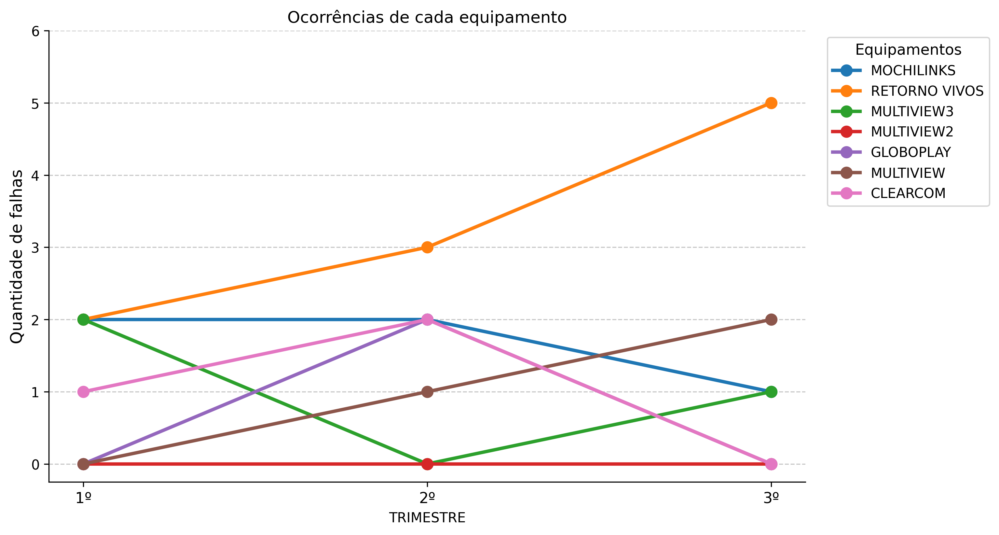
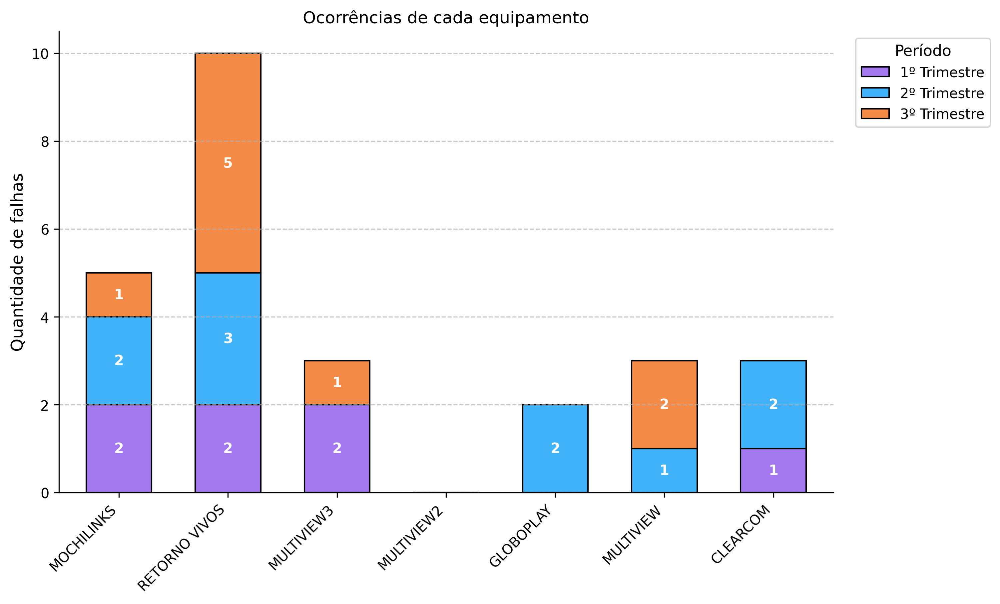
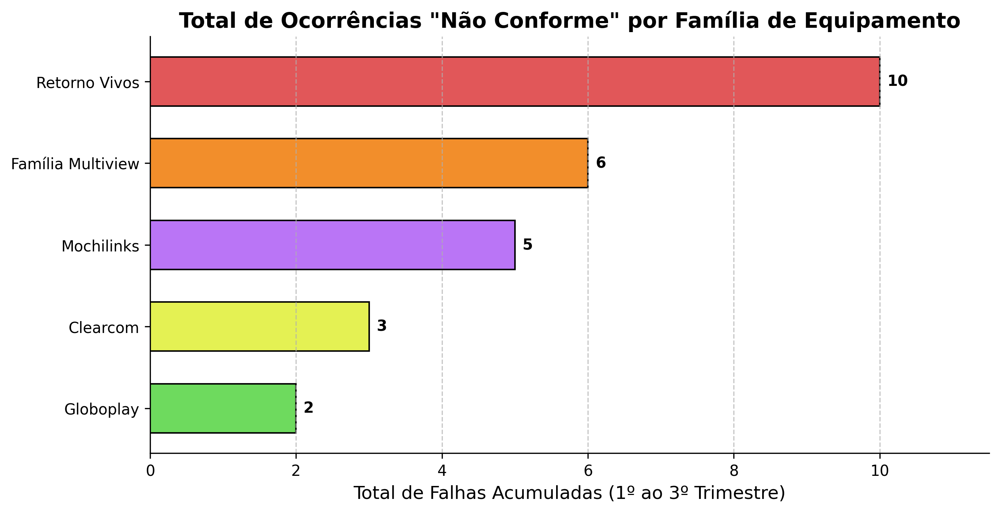

<div align="center">

# 📡 Monitoramento & Análise de Falhas em Equipamentos de TV
### *Broadcast Equipment Monitoring & Failure Analysis*

[](https://www.python.org/)
[](https://pandas.pydata.org/)
[](https://numpy.org/)
[](https://matplotlib.org/)
[](https://jupyter.org/)

<p>
  <a href="#-português">🇧🇷 <b>Português</b></a>
  &nbsp;&nbsp;•&nbsp;&nbsp;
  <a href="#-english">🇺🇸 <b>English</b></a>
</p>

</div>

---

## 🇧🇷 Português

### 📋 Sobre o Projeto

Este projeto realiza o **tratamento (ETL), modelagem dimensional e análise exploratória/preditiva de falhas** em equipamentos críticos de engenharia de uma emissora de televisão. A partir de registros diários de inspeção técnica (`Relatorio Tecnologia.csv`), os dados são processados em **Python** com **Pandas** e **NumPy**, e transformados em indicadores de criticidade e visualizações estratégicas com **Matplotlib** em **Jupyter Notebooks**.

O conjunto de dados abrange **414 registros de inspeção** distribuídos ao longo de **234 dias únicos** (de **01/01/2026 a 30/09/2026**, 1º ao 3º trimestre), monitorando **7 sistemas operacionais**:

| Equipamento (Coluna CSV) | Ativo | Família / Categoria |
| :--- | :--- | :--- |
| `RETORNO VIVOS` | Retorno de Vivos | Retorno e Monitoração |
| `MOCHILINKS` | Mochilinks LiveU | Transmissão Externa |
| `MULTIVIEW` | Multiview Central | Mosaico / Multiview |
| `MULTIVIEW2` | Multiview 2 | Mosaico / Multiview |
| `MULTIVIEW3` | Multiview 3 (CPA) | Mosaico / Multiview |
| `CLEARCOM` | Matriz Clear-Com | Intercomunicação de Voz |
| `GLOBOPLAY` | Globoplay | Distribuição Digital |

---

### 📈 Principais Resultados e Indicadores

Durante o período analisado (Q1 a Q3 de 2026), foram contabilizadas **26 ocorrências de `NÃO CONFORME`**:

- **Principal ponto de atenção:** `RETORNO VIVOS` concentrou **10 falhas (38,5% do total)**, apresentando uma **tendência crescente** ao longo dos trimestres (Q1: 2 → Q2: 3 → Q3: 5).
- **Família de equipamentos:** Agrupando os sistemas, **Retorno Vivos (10)** lidera em volume de falhas, seguido pela **Família Multiview (6)** e **Mochilinks (5)**.
- **Estabilidade:** `MULTIVIEW2` manteve **100% de conformidade** (0 falhas registradas no período).

<details>
<summary><b>📊 Ver tabela completa de falhas por equipamento e trimestre</b></summary>

| Equipamento | Q1 | Q2 | Q3 | Total de Falhas | Participação (%) |
| :--- | :---: | :---: | :---: | :---: | :---: |
| **RETORNO VIVOS** | 2 | 3 | 5 | **10** | 38,5% |
| **MOCHILINKS** | 2 | 2 | 1 | **5** | 19,2% |
| **MULTIVIEW3** | 2 | 0 | 1 | **3** | 11,5% |
| **MULTIVIEW** | 0 | 1 | 2 | **3** | 11,5% |
| **CLEARCOM** | 1 | 2 | 0 | **3** | 11,5% |
| **GLOBOPLAY** | 0 | 2 | 0 | **2** | 7,7% |
| **MULTIVIEW2** | 0 | 0 | 0 | **0** | 0,0% |
| **Total Geral** | **7** | **10** | **9** | **26** | **100,0%** |

</details>

---

### 🖼️ Visualizações Geradas

As visualizações abaixo são exportadas diretamente pelo notebook `etl.ipynb` em alta resolução (`300 dpi`):

#### 1. Evolução Trimestral por Equipamento


#### 2. Distribuição Empilhada por Período


#### 3. Total Acumulado por Família de Equipamentos


---

### 🧱 Arquitetura dos Notebooks

O fluxo de dados é dividido em dois notebooks complementares:

1. **`etl.ipynb` — Análise Exploratória e Visualização**
   - Leitura do CSV com codificação `cp1252` e padronização de datas (`pd.to_datetime`).
   - Criação de colunas derivadas (`TRIMESTRE`, `QTD_FALHAS`) e tratamento de valores nulos (`fillna('Sem ocorrências')`).
   - Agrupamentos por trimestre, equipamento e família, além da geração dos gráficos de barras, linhas e barras empilhadas.

2. **`etl2.ipynb` — Modelagem Dimensional (Star Schema) e Criticidade**
   - Estruturação da dimensão **`EQUIPAMENTO`** (`id_equipamento`, `nome_ativo`, `categoria_familia`, `limite_toleravel`).
   - Estruturação da dimensão **`TEMPO`** (`id_bloco`, `data_referencia`, `mes`, `ano`, `trimestre_bloco`).
   - Construção da tabela fato **`OCORRÊNCIAS`** via `pd.melt()` e junções (`merge`), gerando o **Ranking de Criticidade** com contagem absoluta e taxa percentual de falhas.

---

### 🗂️ Estrutura do Repositório

```text
Topicos-bigdata-Python-com-pandas/
├── data/
│   └── RelatorioTecnologia.csv   # Base de dados principal (CSV)
├── etl.ipynb                     # Notebook de ETL, agregações e gráficos Matplotlib
├── etl2.ipynb                    # Notebook de modelagem dimensional e ranking de criticidade
├── Relatorio Tecnologia.csv      # Cópia da base na raiz (utilizada pelo etl.ipynb)
├── Relatorio Tecnologia.xlsx     # Planilha original de referência
├── slide2_familias.png           # Gráfico: total de falhas por família
├── slide3_empilhado.png          # Gráfico: falhas empilhadas por trimestre
├── slide4_evolucao.png           # Gráfico: evolução trimestral por equipamento
└── README.md                     # Documentação bilíngue do projeto
```

---

### 🚀 Como Executar

1. **Clone o repositório:**
   ```bash
   git clone https://github.com/thalesboss/Topicos-bigdata-Python-com-pandas.git
   cd Topicos-bigdata-Python-com-pandas
   ```

2. **Crie e ative um ambiente virtual:**
   ```bash
   python3 -m venv venv
   source venv/bin/activate        # macOS / Linux
   # venv\Scripts\activate         # Windows
   ```

3. **Instale as dependências:**
   ```bash
   pip install pandas numpy matplotlib jupyter
   ```

4. **Execute os notebooks:**
   ```bash
   jupyter notebook
   ```
   Abra `etl.ipynb` ou `etl2.ipynb` e execute as células em ordem.

---

### 👥 Equipe

- **Rodrigo**
- **Thales Motta**
- **Davi Mendonça**
- **Rodrigo Coelho**

---

## 🇺🇸 English

### 📋 About the Project

This project performs **ETL (Extract, Transform, Load), dimensional modeling, and exploratory/predictive failure analysis** on critical broadcast engineering equipment for a television network. Using daily technical inspection logs (`Relatorio Tecnologia.csv`), data is processed in **Python** with **Pandas** and **NumPy**, and turned into criticality metrics and visual reports with **Matplotlib** inside **Jupyter Notebooks**.

The dataset comprises **414 inspection records** across **234 unique days** (from **2026-01-01 to 2026-09-30**, Q1 through Q3), monitoring **7 operational systems**:

| Equipment (CSV Column) | Asset Name | Family / Category |
| :--- | :--- | :--- |
| `RETORNO VIVOS` | Retorno de Vivos | Return & Monitoring |
| `MOCHILINKS` | Mochilinks LiveU | Field Transmission |
| `MULTIVIEW` | Multiview Central | Mosaic / Multiview |
| `MULTIVIEW2` | Multiview 2 | Mosaic / Multiview |
| `MULTIVIEW3` | Multiview 3 (CPA) | Mosaic / Multiview |
| `CLEARCOM` | Matriz Clear-Com | Voice Intercom |
| `GLOBOPLAY` | Globoplay | Digital Distribution |

---

### 📈 Key Findings & Metrics

Across the analyzed period (Q1–Q3 2026), **26 non-conformity (`NÃO CONFORME`) events** were recorded:

- **Top critical asset:** `RETORNO VIVOS` accounted for **10 failures (38.5% of total)**, showing an **upward trend** across quarters (Q1: 2 → Q2: 3 → Q3: 5).
- **Equipment families:** Grouping by family, **Retorno Vivos (10)** leads in total failures, followed by the **Multiview Family (6)** and **Mochilinks (5)**.
- **Highest reliability:** `MULTIVIEW2` achieved **100% compliance** (0 failures recorded).

<details>
<summary><b>📊 View full failure breakdown by equipment and quarter</b></summary>

| Equipment | Q1 | Q2 | Q3 | Total Failures | Share (%) |
| :--- | :---: | :---: | :---: | :---: | :---: |
| **RETORNO VIVOS** | 2 | 3 | 5 | **10** | 38.5% |
| **MOCHILINKS** | 2 | 2 | 1 | **5** | 19.2% |
| **MULTIVIEW3** | 2 | 0 | 1 | **3** | 11.5% |
| **MULTIVIEW** | 0 | 1 | 2 | **3** | 11.5% |
| **CLEARCOM** | 1 | 2 | 0 | **3** | 11.5% |
| **GLOBOPLAY** | 0 | 2 | 0 | **2** | 7.7% |
| **MULTIVIEW2** | 0 | 0 | 0 | **0** | 0.0% |
| **Grand Total** | **7** | **10** | **9** | **26** | **100.0%** |

</details>

---

### 🖼️ Generated Visualizations

The charts below are exported directly from `etl.ipynb` at high resolution (`300 dpi`):

#### 1. Quarterly Trend per Equipment


#### 2. Stacked Distribution by Period


#### 3. Accumulated Failures by Equipment Family


---

### 🧱 Notebook Architecture

The pipeline is organized into two complementary notebooks:

1. **`etl.ipynb` — Exploratory Analysis & Visualization**
   - Loads the CSV with `cp1252` encoding and parses dates (`pd.to_datetime`).
   - Engineers derived features (`TRIMESTRE`, `QTD_FALHAS`) and handles missing values (`fillna('Sem ocorrências')`).
   - Aggregates failures by quarter, equipment, and family, producing bar, line, and stacked bar charts.

2. **`etl2.ipynb` — Dimensional Modeling (Star Schema) & Criticality**
   - Builds the **`EQUIPAMENTO`** dimension (`id_equipamento`, `nome_ativo`, `categoria_familia`, `limite_toleravel`).
   - Builds the **`TEMPO`** dimension (`id_bloco`, `data_referencia`, `mes`, `ano`, `trimestre_bloco`).
   - Constructs the **`OCORRÊNCIAS`** fact table using `pd.melt()` and relational merges, outputting a **Criticality Ranking** with failure counts and percentage shares.

---

### 🗂️ Repository Structure

```text
Topicos-bigdata-Python-com-pandas/
├── data/
│   └── RelatorioTecnologia.csv   # Main dataset (CSV)
├── etl.ipynb                     # ETL, aggregations, and Matplotlib charts
├── etl2.ipynb                    # Dimensional modeling and criticality ranking
├── Relatorio Tecnologia.csv      # Root copy of the dataset (used by etl.ipynb)
├── Relatorio Tecnologia.xlsx     # Original reference spreadsheet
├── slide2_familias.png           # Chart: total failures by equipment family
├── slide3_empilhado.png          # Chart: stacked failures by quarter
├── slide4_evolucao.png           # Chart: quarterly evolution per equipment
└── README.md                     # Bilingual project documentation
```

---

### 🚀 Getting Started

1. **Clone the repository:**
   ```bash
   git clone https://github.com/thalesboss/Topicos-bigdata-Python-com-pandas.git
   cd Topicos-bigdata-Python-com-pandas
   ```

2. **Create and activate a virtual environment:**
   ```bash
   python3 -m venv venv
   source venv/bin/activate        # macOS / Linux
   # venv\Scripts\activate         # Windows
   ```

3. **Install dependencies:**
   ```bash
   pip install pandas numpy matplotlib jupyter
   ```

4. **Run the notebooks:**
   ```bash
   jupyter notebook
   ```
   Open `etl.ipynb` or `etl2.ipynb` and run all cells sequentially.

---

### 👥 Team

- **Rodrigo**
- **Thales Motta**
- **Davi Mendonça**
- **Rodrigo Coelho**
